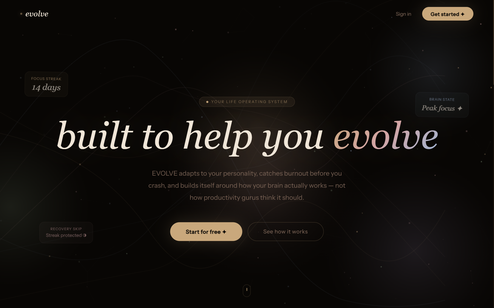
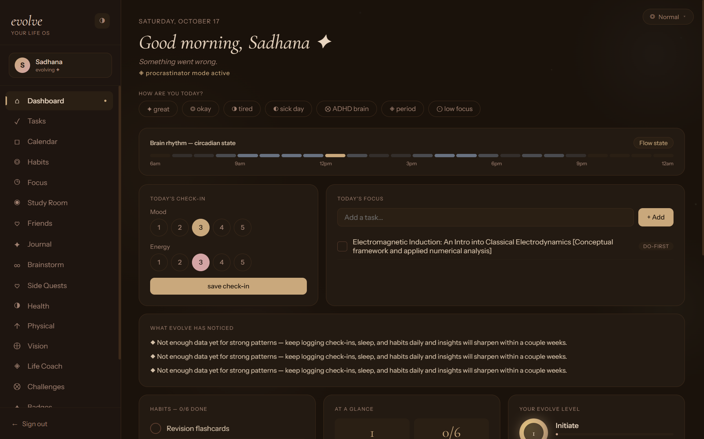

<div align="center">


<br/>

[**Explore the live app ↗**](https://evolvenowv2.vercel.app/) &nbsp; · &nbsp; [**Source code**](https://github.com/Sadh-ana/evolve-now-v2)

<br/>


</div>

---

<div align="center">

## A life doesn't change overnight.
### It changes in the little things you do consistently.

</div>

Evolve Now is a personal growth and planning project built around a simple belief: **becoming better doesn't require becoming someone else.**

It's about creating space for your ambitions, building habits that support you, and turning the person you want to become into the person you're actively working toward.

## ✦ The experience

<table>
<tr>
<td width="50%" valign="top">

### 01 · Plan with intention

Bring structure to your ambitions. Break down what matters into steps you can actually take.

</td>
<td width="50%" valign="top">

### 02 · Build consistency

Create routines around the person you're becoming, one small action at a time.

</td>
</tr>
<tr>
<td width="50%" valign="top">

### 03 · Make progress visible

Give yourself a way to recognise the effort you're putting in, not just the finish line.

</td>
<td width="50%" valign="top">

### 04 · Keep evolving

Treat personal growth as an ongoing practice rather than a destination.

</td>
</tr>
</table>

> **Note:** These describe the product's intended direction. Keep them only if they accurately represent the experience your current app provides.


## ◇ Inside the experience

*Designed for the person you're becoming.*

<br/>



<br/>

<sub>01 / THE VISION</sub>

### A little more intentional. A little more you.

<br/><br/>




<br/>

<sub>02 / YOUR PERSONAL WORKSPACE</sub>

*Turn the things you want to change into progress you can see.*

</div>


## ⌘ Built with

<div align="center">


</div>

## ↗ Run locally

You'll need [Node.js](https://nodejs.org/) and npm.

```bash
git clone https://github.com/Sadh-ana/evolve-now-v2.git
cd evolve-now-v2
npm install
npm run dev
```

Open the local development URL shown in your terminal.

If the application requires environment variables, configure them using the project's existing environment setup before running it.


<div align="center">


---

<div align="center">

### GROWTH, AT YOUR OWN PACE.

*You are allowed to be a work in progress.*

<br/>


<br/><br/>

**[Explore Evolve Now ↗](https://evolvenowv2.vercel.app/)**


**Created by [Sadh-ana](https://github.com/Sadh-ana) ♡**

<sub>Small steps. Honest effort. A life designed deliberately.</sub>

</div>
